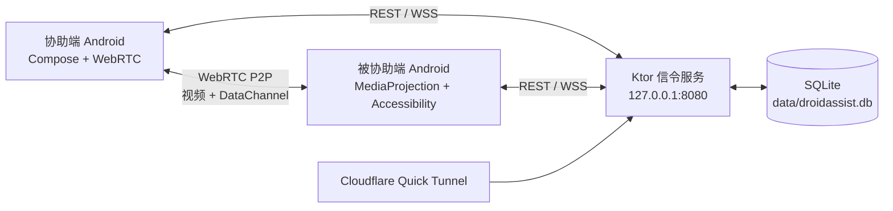
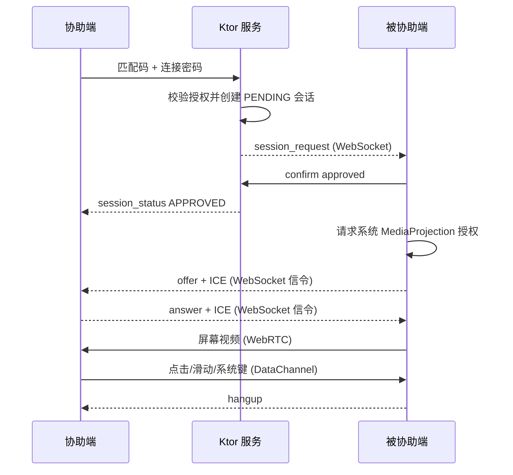

# DroidAssist 架构说明

## 1. 目标与边界

DroidAssist 采用“中心服务负责身份、授权和信令，终端负责媒体与控制”的架构。Mac 上的服务端不会接收或保存屏幕视频，远程画面和控制指令在两台 Android 设备之间通过 WebRTC 传输。

当前系统面向双机功能验证，不是生产级远控平台。它没有 TURN 中继、多节点部署、账户体系、审计平台或端到端业务身份签名。

## 2. 总体架构

公网手机通过 Quick Tunnel 的 HTTPS/WSS 地址访问 Ktor。Android 模拟器也可以直接使用 `http://10.0.2.2:8080`，同一局域网内的真机可以使用 Mac 的局域网地址。无论服务入口如何变化，WebRTC 建连后的视频和控制流都不经过 Ktor HTTP 接口。

## 3. 模块职责

### `app`

- `MainActivity`：Compose 根入口、通知权限和 MediaProjection 系统授权结果处理。
- `AssistViewModel`：UI 状态、DataStore 持久化、REST 调用、WebSocket 重连和会话信号分发。
- `ui/DroidAssistApp`：设备、本机、设置三个主页面，以及独立远控画面和底部控制面板。
- `data/AssistApi`：Ktor Client 的 REST 与 WebSocket 客户端。
- `data/DeviceIdentity`：安装标识、设备名称和 Android Keystore EC 公钥。
- `webrtc/WebRtcManager`：PeerConnection、SDP、ICE、屏幕视频轨道、DataChannel 和会话清理。
- `service/ScreenShareService`：MediaProjection 前台服务生命周期。
- `service/RemoteControlService`：AccessibilityService 手势及系统导航动作。

### `protocol`

集中定义客户端和服务端共享的 Kotlin Serialization 模型，避免 REST 与 WebSocket 字段在两端漂移。主要模型包括设备注册、授权、会话确认、设备管理和 `SignalEnvelope`。

### `server`

- `Application`：Ktor CIO、REST 路由、WebSocket 连接表、设备认证和信令转发。
- `Database`：SQLite 表结构及设备、授权、会话、在线状态操作。
- `Security`：随机令牌、匹配码、连接密码和哈希校验。

### `deploy/mac`

使用 Gradle `installDist` 生成服务端运行目录，再通过 `launchctl submit` 管理 Ktor 与 `cloudflared` 两个进程。运行日志和当前公网地址写入 `.runtime/`。

## 4. 服务接口

### REST

| 方法与路径 | 作用 | 认证 |
| --- | --- | --- |
| `GET /health` | 健康检查 | 无 |
| `POST /api/v1/devices/register` | 注册或刷新设备令牌 | 无，使用 installation ID 识别安装实例 |
| `POST /api/v1/grants` | 创建临时或永久授权 | Bearer 设备令牌 |
| `POST /api/v1/sessions/connect` | 使用匹配码和密码创建待确认会话 | Bearer 设备令牌 |
| `POST /api/v1/sessions/{id}/confirm` | 被协助端允许或拒绝会话 | Bearer 设备令牌 |
| `GET /api/v1/sessions/{id}` | 查询会话状态 | Bearer 设备令牌 |
| `GET /api/v1/management` | 查询在线设备和可信设备 | Bearer 设备令牌 |
| `DELETE /api/v1/grants/{peerId}` | 撤销对指定设备的授权 | Bearer 设备令牌 |

### WebSocket

连接地址为 `/signal/{deviceId}?token={deviceToken}`。服务端验证令牌与路径中的设备 ID 一致后，将该连接登记为在线；断开时更新离线状态。

`SignalEnvelope` 包含会话 ID、发送设备、接收设备、信号类型和 JSON payload。当前信号类型：

- `session_request`：服务端通知被协助端存在新请求。
- `session_status`：服务端通知协助端允许、拒绝或关闭状态。
- `offer`、`answer`：WebRTC SDP 协商。
- `ice`：ICE candidate。
- `control`：协议预留类型；实际实时控制走 WebRTC DataChannel。
- `hangup`：任一终端结束会话并触发对端资源清理。

Android 端 WebSocket 异常断开后每 2 秒尝试重连。它是实时通知和信令通道，不使用轮询获取连接请求。

## 5. 会话时序

关键顺序：

1. 协助端创建会话后配置为 controller，但等待被协助端确认。
2. 被协助端只在确认成功后配置 controlled 角色并触发系统录屏授权。
3. `ScreenShareService` 将授权结果交给 `WebRtcManager`，后者创建视频轨道、DataChannel 和 offer。
4. 远端 SDP 尚未设置时收到的 ICE candidate 会暂存，设置成功后统一应用，避免 candidate 时序竞争。
5. 协助端收到远程视频轨道后标记画面就绪，UI 自动进入独立远控页面。

## 6. 画面与控制

被协助端使用 `ScreenCapturerAndroid` 采集默认显示屏。当前实现保持设备宽高比，把最长边限制为 1280 像素并以 20 fps 请求采集。视频轨道通过 WebRTC 发送，协助端使用 `SurfaceViewRenderer` 渲染并按照远端屏幕宽高比布局。

远控页面把触摸位置归一化到 `0..1` 坐标，DataChannel 发送文本控制命令：

| 命令 | AccessibilityService 行为 |
| --- | --- |
| `{"type":"tap","x":...,"y":...}` | 单击 |
| `{"type":"long_press","x":...,"y":...,"duration":...}` | 长按 |
| `{"type":"swipe","fromX":...,"fromY":...,"toX":...,"toY":...,"duration":...}` | 滑动 |
| `{"type":"global","action":"BACK"}` | 返回 |
| `{"type":"global","action":"HOME"}` | Home |
| `{"type":"global","action":"RECENTS"}` | 最近任务 |

被协助端将归一化坐标转换为当前屏幕像素，再通过 `dispatchGesture` 执行。全局按键使用无障碍服务的 `performGlobalAction`。

## 7. 数据与状态

### Android 本地数据

- SharedPreferences：installation ID。
- Android Keystore：设备身份 EC 密钥对。
- DataStore：服务地址、设备 ID、设备令牌、匹配码和最近使用的匹配码列表。
- 内存：当前授权、待确认会话、PeerConnection、媒体轨道和 DataChannel。

### SQLite

- `devices`：设备 ID、安装标识、显示名称、公钥、匹配码、令牌哈希、在线状态和最后活动时间。
- `grants`：授权所有者、目标设备、类型、密码哈希、有效期、使用状态、失败次数和可信状态。
- `sessions`：协助端、被协助端、授权、状态、过期时间和创建时间。

设备令牌和连接密码不以明文存入数据库。屏幕帧、触控内容和 MediaProjection 授权数据不会写入 SQLite。

## 8. 授权与安全边界

- 临时授权的有效期被限制在 60 到 3600 秒，当前客户端使用默认 600 秒；验证成功后即标记为已使用。
- 同一授权连续失败 5 次后不再接受。
- 每个连接仍需被协助端明确允许，并再次通过 Android 系统录屏确认。
- “可信设备”记录可在设备页查看和撤销，但不会绕过 Android 系统安全确认。
- WebSocket 信令按设备令牌认证；服务端只向指定设备的当前连接转发信号。
- WebRTC 默认使用 DTLS/SRTP 保护 DataChannel 和媒体传输。

## 9. 结束与清理

停止共享或退出会话时，`WebRtcManager` 先发送 `hangup`，随后停止屏幕采集，释放 capturer、视频源、纹理线程、DataChannel 和 PeerConnection，并重置远程画面与连接状态。对端收到 `hangup` 后执行同样的本地清理，因此协助端不会停留在最后一帧冻结画面。

Android 前台服务被停止时也会触发共享清理。应用 ViewModel 销毁时会关闭 WebSocket 客户端并释放当前 WebRTC 会话。

## 10. 可扩展方向

生产化时建议按优先级加入：自建固定域名和 TLS、coturn 中继、账户与设备所有权体系、一次性挑战签名、服务端限流和审计、会话超时强制关闭、网络质量自适应、后台保活策略、崩溃监控以及自动化真机回归测试。
